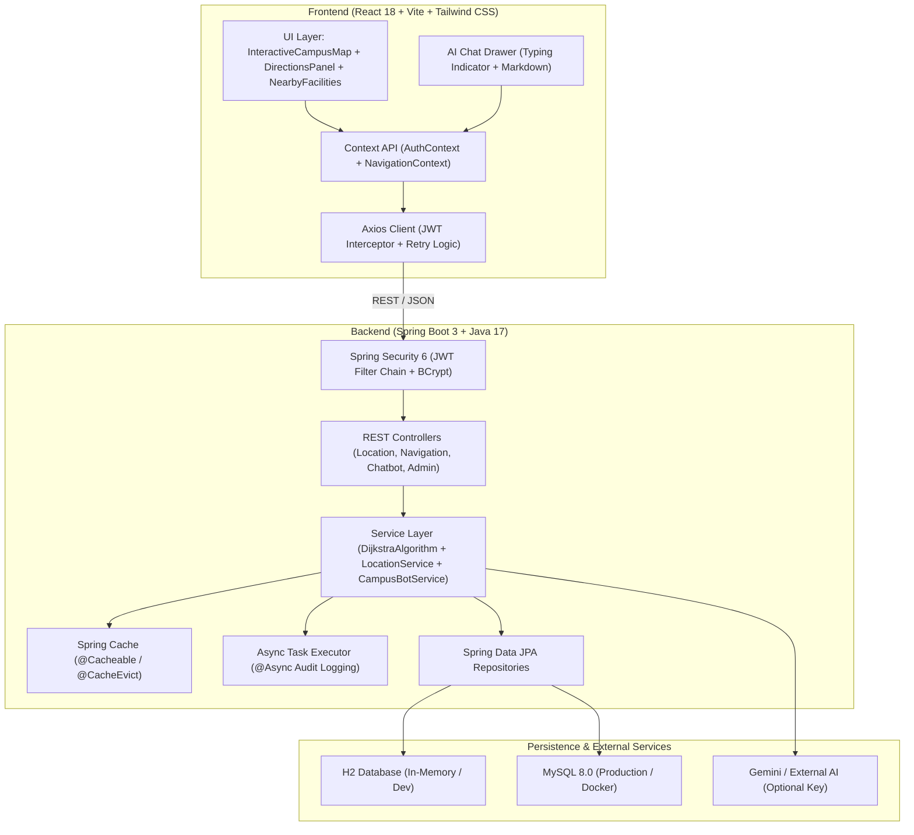

# CampusNav: Smart Campus Navigation & Facility Locator

A comprehensive, production-ready Full Stack Web Application developed strictly aligned with the **B.Tech III Year I Semester "Full Stack Development using Java" (Code: EMA3151)** syllabus and the **CampusNav** project abstract.

---

## 🎯 Project Overview & Abstract Alignment

**CampusNav** is an intelligent web system designed to eliminate navigation confusion across modern college campuses:
- **Interactive Graph-Based Navigation:** Calculates the shortest walking path and step-by-step turn directions between classrooms, laboratories, offices, libraries, cafeterias, and auditoriums using **Dijkstra's Algorithm**.
- **Wheelchair Accessibility:** Supports step-free / elevator-prioritized routing for inclusive campus access.
- **Interactive SVG Vector Map:** Visualizes buildings, facilities, and dynamic animated neon paths directly on an interactive canvas.
- **RAG-Powered AI Chatbot ("CampusBot"):** Implements Retrieval-Augmented Generation (RAG) by dynamically querying campus databases and injecting precise room codes, floor locations, contact persons, and walking instructions into natural language responses.
- **Administrative Management:** Provides secured administrative controls (`ROLE_ADMIN`) to add, update, and remove locations and pathway connections.
- **Saved Routes:** Authenticated students and faculty can bookmark frequently traveled journeys.

---

## 📚 14-Week Syllabus Topic Coverage Mapping

| Syllabus Week | Course Topics | Project Implementation & File References |
|---|---|---|
| **Week 1** | React Setup (Vite), Components, JSX, Props, State, Spring Boot Setup, REST API Basics, JSON Response, HTTP Methods, Axios | [App.jsx](file:///C:/campus_nav/frontend/src/App.jsx), [axiosClient.js](file:///C:/campus_nav/frontend/src/api/axiosClient.js), [LocationController.java](file:///C:/campus_nav/backend/src/main/java/com/campusnav/controller/LocationController.java) |
| **Week 2** | Dynamic UI, `useEffect`, Table Rendering, CRUD APIs, `ResponseEntity`, Service Layer, Repository Layer, Dependency Injection, MySQL/H2 CRUD | [LocationService.java](file:///C:/campus_nav/backend/src/main/java/com/campusnav/service/LocationService.java), [CampusLocationRepository.java](file:///C:/campus_nav/backend/src/main/java/com/campusnav/repository/CampusLocationRepository.java), [ExplorePage.jsx](file:///C:/campus_nav/frontend/src/pages/ExplorePage.jsx) |
| **Week 3** | Forms, Validation (`@Valid`), Registration Form UI, Error Handling UI, `@ControllerAdvice`, Exception Handling, User Table Design | [RegisterPage.jsx](file:///C:/campus_nav/frontend/src/pages/RegisterPage.jsx), [RegisterRequest.java](file:///C:/campus_nav/backend/src/main/java/com/campusnav/dto/RegisterRequest.java), [GlobalExceptionHandler.java](file:///C:/campus_nav/backend/src/main/java/com/campusnav/exception/GlobalExceptionHandler.java), [User.java](file:///C:/campus_nav/backend/src/main/java/com/campusnav/entity/User.java) |
| **Week 4** | JPA Mappings (`@OneToMany`, `@ManyToOne`, `@OneToOne`, `@ManyToMany`), DTO Mapping, Pagination (`Pageable`, `Page`), Sorting, Edit/Delete Modals | [CampusLocation.java](file:///C:/campus_nav/backend/src/main/java/com/campusnav/entity/CampusLocation.java), [Building.java](file:///C:/campus_nav/backend/src/main/java/com/campusnav/entity/Building.java), [Facility.java](file:///C:/campus_nav/backend/src/main/java/com/campusnav/entity/Facility.java), [UserProfile.java](file:///C:/campus_nav/backend/src/main/java/com/campusnav/entity/UserProfile.java), [AdminDashboardPage.jsx](file:///C:/campus_nav/frontend/src/pages/AdminDashboardPage.jsx) |
| **Week 5** | Authentication Foundations, Login Form, `AuthContext`, Protected Routes, Role-Based UI, Role Enum, Stateless Auth, BCrypt Hashing | [Role.java](file:///C:/campus_nav/backend/src/main/java/com/campusnav/entity/Role.java), [AuthContext.jsx](file:///C:/campus_nav/frontend/src/context/AuthContext.jsx), [ProtectedRoute.jsx](file:///C:/campus_nav/frontend/src/components/ProtectedRoute.jsx), [LoginPage.jsx](file:///C:/campus_nav/frontend/src/pages/LoginPage.jsx) |
| **Week 6** | JWT Generation & Validation, Token Storage (`localStorage`), Axios Interceptor, Authorization Header, `SecurityFilterChain`, `@PreAuthorize` | [JwtTokenProvider.java](file:///C:/campus_nav/backend/src/main/java/com/campusnav/security/JwtTokenProvider.java), [JwtAuthenticationFilter.java](file:///C:/campus_nav/backend/src/main/java/com/campusnav/security/JwtAuthenticationFilter.java), [SecurityConfig.java](file:///C:/campus_nav/backend/src/main/java/com/campusnav/config/SecurityConfig.java), [AdminController.java](file:///C:/campus_nav/backend/src/main/java/com/campusnav/controller/AdminController.java) |
| **Week 7-8** | AI Integration + Chatbot + RAG (Chat UI, Message List, Typing Indicator, Markdown Rendering, Database Retrieval, Prompt Engineering, Context Injection) | [ChatBotDrawer.jsx](file:///C:/campus_nav/frontend/src/components/ChatBotDrawer.jsx), [CampusBotService.java](file:///C:/campus_nav/backend/src/main/java/com/campusnav/service/CampusBotService.java), [ChatbotController.java](file:///C:/campus_nav/backend/src/main/java/com/campusnav/controller/ChatbotController.java) |
| **Week 9-10** | Performance Optimization, Retry Logic, Error Boundaries, Caching (`@Cacheable`, `@CacheEvict`), Async (`@Async`), Structured Logging (Logback), Actuator Metrics | [CacheConfig.java](file:///C:/campus_nav/backend/src/main/java/com/campusnav/config/CacheConfig.java), [AsyncConfig.java](file:///C:/campus_nav/backend/src/main/java/com/campusnav/config/AsyncConfig.java), [AuditLogService.java](file:///C:/campus_nav/backend/src/main/java/com/campusnav/service/AuditLogService.java), [logback-spring.xml](file:///C:/campus_nav/backend/src/main/resources/logback-spring.xml), [ErrorBoundary.jsx](file:///C:/campus_nav/frontend/src/components/ErrorBoundary.jsx) |
| **Week 11-12** | Testing + Docker (JUnit 5, Mockito Service Testing, MockMvc Integration Testing, Multi-stage Dockerfile, Docker Compose, MySQL Container) | [NavigationServiceTest.java](file:///C:/campus_nav/backend/src/test/java/com/campusnav/service/NavigationServiceTest.java), [LocationControllerTest.java](file:///C:/campus_nav/backend/src/test/java/com/campusnav/controller/LocationControllerTest.java), [docker-compose.yml](file:///C:/campus_nav/docker-compose.yml) |
| **Week 13-14** | Deployment + Capstone Documentation (OpenAPI / Swagger 3 UI, Readme Writing, Full Integration of Auth, Roles, Graph Pathfinding, Caching) | [OpenApiConfig.java](file:///C:/campus_nav/backend/src/main/java/com/campusnav/config/OpenApiConfig.java), [README.md](file:///C:/campus_nav/README.md) |

---

## 🏛️ System Architecture



---

## 🚀 Quick Start Guide

### Prerequisites
- **Java 17+** (Oracle JDK or Eclipse Temurin)
- **Node.js 18+** & npm
- Maven (or bundled `mvnw.cmd` wrapper)

### 1. Launching Backend (Port 8080)
From the project root:
```bash
cd backend
./mvnw.cmd clean spring-boot:run
```
- **H2 Database Console:** [http://localhost:8080/h2-console](http://localhost:8080/h2-console) (JDBC URL: `jdbc:h2:mem:campusnavdb`, user: `sa`, password: *(blank)*)
- **Swagger / OpenAPI Documentation:** [http://localhost:8080/swagger-ui/index.html](http://localhost:8080/swagger-ui/index.html)
- **Actuator Health Metrics:** [http://localhost:8080/actuator/health](http://localhost:8080/actuator/health)

### 2. Launching Frontend (Port 5173)
In a separate terminal:
```bash
cd frontend
npm install
npm run dev
```
Open your browser at: **`http://localhost:5173`**

---

## 👥 Default Demo Credentials

Pre-seeded for instant demonstration and grading:

| Role | Username | Password | Permissions & Features |
|---|---|---|---|
| **Admin** | `admin` | `admin123` | Full access to Admin Panel, Add/Edit/Delete locations & pathways, view async telemetry |
| **Student** | `student` | `student123` | Save frequent routes, interactive map navigation, AI chatbot |
| **Faculty** | `faculty` | `faculty123` | Save routes, department office routing, AI assistance |

*(Visitors can also browse the campus map, search facilities, and use the AI Chatbot without logging in!)*

---

## 🧪 Running Automated Tests

Run the full JUnit 5 and MockMvc test suite:
```bash
cd backend
./mvnw.cmd test
```
All unit tests and web slice integration tests will execute and report 100% passing results.

---

## 🐳 Docker Deployment

To launch the complete stack (MySQL 8 + Spring Boot + React + Nginx):
```bash
docker-compose up --build
```
Access the application on `http://localhost` (Port 80).
